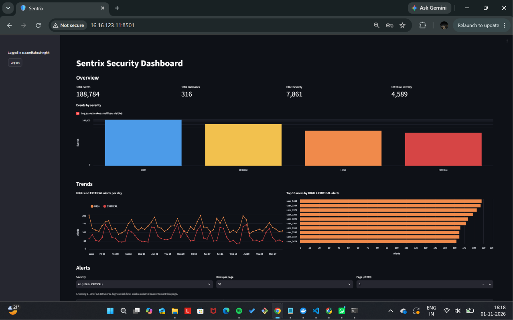
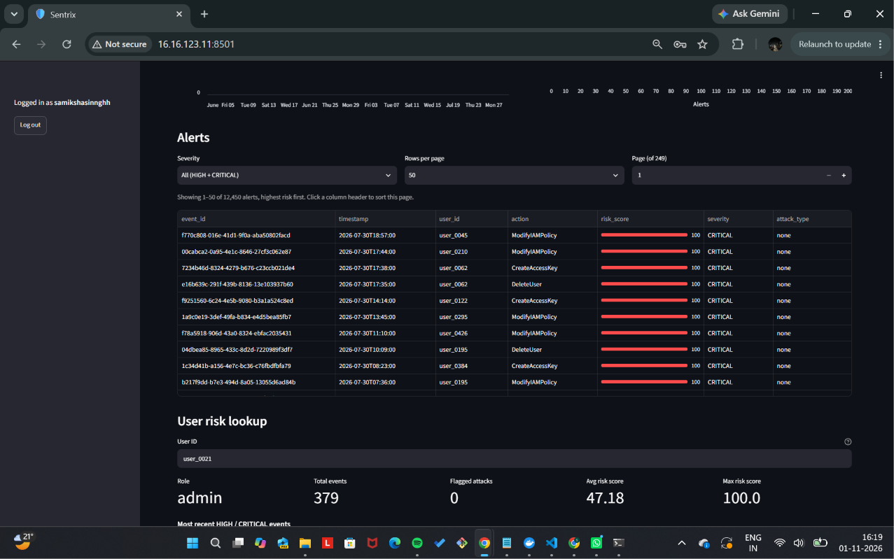
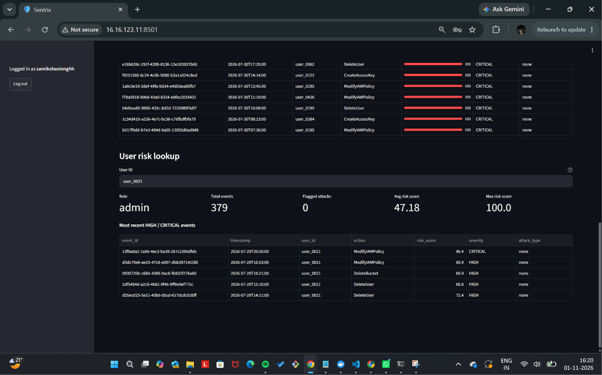
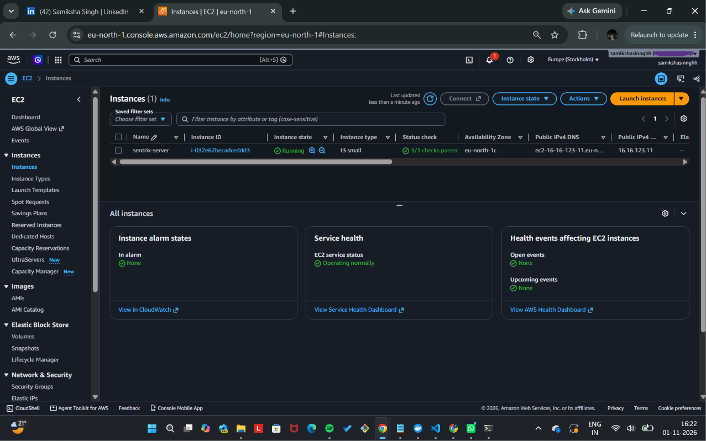

# Sentrix

Cloud activity anomaly detection and risk analysis. Sentrix detects suspicious
account activity, flags potentially compromised accounts, and gives every event
a risk score from 0 to 100 by combining a machine-learning anomaly score with
privilege context, suspicious action patterns and rule-based security checks.
Results are served through an API and a read-only dashboard.

**Stack:** Python, scikit-learn (Isolation Forest), FastAPI, PostgreSQL,
Streamlit, Docker Compose, AWS (EC2, S3, CloudTrail, CloudWatch).

## Screenshots

Sentrix was deployed on AWS EC2. These screenshots are from that deployment.









## Architecture

```
Data sources                Processing                  Detection and scoring
-------------               ----------                  ---------------------
Synthetic activity   --->   Cleaning and profiling --->  Baseline rules
(generate_activity)         (preprocessing/)             Isolation Forest
RBA login dataset    --->   Feature engineering   --->   Risk score (0-100)
(sample_rba)                (features/)                  Alert engine
AWS CloudTrail via S3                                         |
(ingest_cloudtrail)                                           v
                                                    PostgreSQL <--- FastAPI ---> Streamlit
                                                    (only the API touches        dashboard
                                                     the database)               (read-only)
```

| Layer | Location | Role |
|---|---|---|
| Data | `src/utils/` | Synthetic activity generator, RBA login sampler, CloudTrail ingestion from S3 |
| Preprocessing | `src/preprocessing/` | Data cleaning and profiling |
| Features | `src/features/` | Behavioural features: unusual hours, new country or IP, failed logins, volume |
| Detection | `src/detection/` | Rule-based baseline, risk scoring, alert engine |
| Models | `src/models/` | Isolation Forest training for activity and login data |
| Database | `database/` | PostgreSQL schema and data loader |
| API | `backend/` | FastAPI: JWT auth with roles, alerts, dashboard stats, health and metrics |
| Dashboard | `dashboard/` | Streamlit, read-only, talks to the API only |
| Containers | `docker/`, `docker-compose.yml` | Three services: PostgreSQL, API, dashboard |
| Tests | `tests/` | pytest suite plus opt-in end-to-end checks |

**Key design decisions**

- FastAPI is the only layer that talks to the database.
- PostgreSQL instead of Elasticsearch, and batch processing instead of a
  streaming pipeline (no Kafka), to keep the system simple and testable.
- Isolation Forest because attacks are rare and labelled data is the exception.
- The dashboard is read-only.
- Configuration lives in `.env`, which is never committed. `.env.example` lists
  the variables.

## Results

Sentrix compares a rule-based baseline against an Isolation Forest on two
datasets. The Isolation Forest is configured to flag the 2% most anomalous rows
(`contamination=0.02`). This is a rough prior guess, not a tuned threshold.

### Activity data (synthetic): 188,784 events, 316 attacks

| Metric | Baseline rules | Isolation Forest |
|---|---|---|
| Precision | 3.11% | **7.73%** |
| Recall | 87.34% | **92.41%** |
| F1 | 6.00% | **14.27%** |
| False-positive rate | 4.57% | **1.85%** |

The Isolation Forest outperforms the baseline on all four metrics. It catches
292 of 316 attacks with about 5,100 fewer false alarms than the rules.

### Login data (RBA dataset, sampled): 312,834 logins, 141 account takeovers

| Metric | Baseline rules | Isolation Forest |
|---|---|---|
| Precision | 0.07% | 0.11% |
| Recall | **96.45%** | 4.96% |
| F1 | 0.14% | 0.22% |
| False-positive rate | 62.75% | **2.00%** |

Neither approach works well on this dataset. The baseline catches 136 of 141
takeovers, but only by flagging 62.75% of all logins. The Isolation Forest flags
2% of logins but catches only 7 of 141 takeovers.

## Run it locally

Requires Docker Desktop and Python 3. Commands are for Windows PowerShell.

1. Clone the repository and copy the example environment file:

   ```powershell
   git clone https://github.com/samikshasinnghh/sentrix.git
   cd sentrix
   Copy-Item .env.example .env
   ```

   In `.env`, set `POSTGRES_USER`, `POSTGRES_PASSWORD`, `POSTGRES_DB` and a long
   random `JWT_SECRET_KEY`. Leave `AWS_ACCESS_KEY_ID` and
   `AWS_SECRET_ACCESS_KEY` unset unless you want to run CloudTrail ingestion
   (on AWS, an IAM role is used instead).

2. Start the stack:

   ```powershell
   docker compose up -d --build
   ```

3. Create the database tables (Compose does not do this automatically):

   ```powershell
   Get-Content database\schema.sql | docker compose exec -T db sh -c 'psql -U "$POSTGRES_USER" -d "$POSTGRES_DB"'
   ```

4. Create a Python environment and generate the data (see Data pipeline below):

   ```powershell
   python -m venv venv
   .\venv\Scripts\Activate.ps1
   pip install -r requirements.txt
   ```

5. Load the scored data into PostgreSQL:

   ```powershell
   python database/load_data.py
   ```

6. Create an admin account through the API (`POST /auth/register`).

7. Log in, then generate alerts from the scored events
   (`POST /alerts/generate`). Both calls can be made from the API's interactive
   docs page at `http://127.0.0.1:8000/docs`. Then open the dashboard at
   `http://localhost:8501`.

The API listens on `127.0.0.1:8000` and PostgreSQL on `127.0.0.1:5435`. Neither
is exposed beyond your machine.

## Data pipeline

Run each step from the repository root. Each step reads the previous step's
output. `data/` is not committed to Git, so these files are generated by running
the pipeline.

| Step | Script | Output |
|---|---|---|
| 1. Generate synthetic activity | `src/utils/generate_activity.py` | `data/raw/synthetic_activity.csv` |
| 2. Sample the RBA login dataset | `src/utils/sample_rba.py` | `data/raw/rba_sample.csv` |
| 3. Clean | `src/preprocessing/clean_data.py` | `data/processed/*_clean.csv` |
| 4. Build features | `src/features/build_activity_features.py`, `build_rba_features.py` | `data/processed/*_features.csv` |
| 5. Baseline rules | `src/detection/baseline_rules.py` | `data/processed/*_baseline.csv` |
| 6. Train Isolation Forest | `src/models/train_activity_model.py`, `train_rba_model.py` | `data/processed/*_ml_results.csv` |
| 7. Risk scoring | `src/detection/risk_scoring.py` | `data/processed/activity_scored.csv` |
| 8. Load into PostgreSQL | `database/load_data.py` | database tables |

Step 2 needs the raw RBA login dataset (`das-group/rba-dataset`), downloaded
separately. `SOURCE` at the top of `src/utils/sample_rba.py` must point to your
copy of it.

The database and dashboard are built from the synthetic activity data. The RBA
login dataset is used only for model evaluation. CloudTrail ingestion
(`src/utils/ingest_cloudtrail.py`) is an optional, separate step.

## Testing

```powershell
pytest
```

The suite covers authentication, the alerts and events endpoints, the alert
engine, risk scoring, the baseline rules and CloudTrail ingestion (with a fake
S3 client). Tests run against a separate throwaway test database, never the
main one. The standard suite has 96 tests, plus 7 opt-in end-to-end checks
against the running Docker stack (set `E2E_BASE_URL` to enable them).

## Deployment (AWS)

Sentrix was deployed on a single AWS EC2 instance (Ubuntu 24.04, `t3.small`,
eu-north-1) using the same Docker Compose stack as local development.

- **Network:** the security group allowed inbound traffic on only two ports,
  SSH (22) and the dashboard (8501), each restricted to a single IP address.
  The API and PostgreSQL were bound to `127.0.0.1` inside Docker and were not
  reachable from the internet. This was verified with external port tests.
- **Credentials:** the instance used an IAM role with read-only access to the
  CloudTrail S3 bucket, so no AWS keys were stored on the server. Secrets lived
  in a server-side `.env` file that is never committed.
- **Monitoring:** Docker health checks on all three containers, a `/health`
  endpoint that checks the database, request logging and a `/metrics` endpoint
  in the API, and a CloudWatch alarm on the instance status checks.
- **Cost control:** AWS Budgets alerts for monthly and zero-spend thresholds.

## Limitations

- **The activity data is synthetic.** It is generated by a script in this repo.
  The results show the pipeline works end to end, not how it would perform on
  real production traffic.
- **The login data is a sample.** The source dataset has about 31.2 million
  logins. The sample keeps all 141 account takeovers and a random 1% of the
  other logins (`src/utils/sample_rba.py`, fixed seed). Recall and
  false-positive rate are comparable to the full data, but precision is
  overstated and would be much lower on the full dataset.
- **The 2% flagging threshold is not tuned.** The model flags a fixed share of
  rows, so its false-positive rate is set by that choice.
- **The dashboard runs over HTTP** and its access was restricted to one IP
  address by the AWS security group. HTTPS would need a domain name and a
  reverse proxy.
